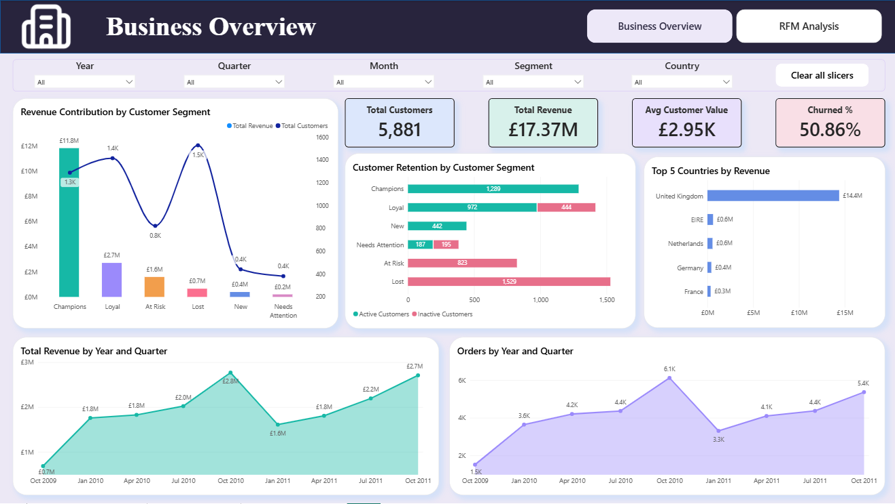
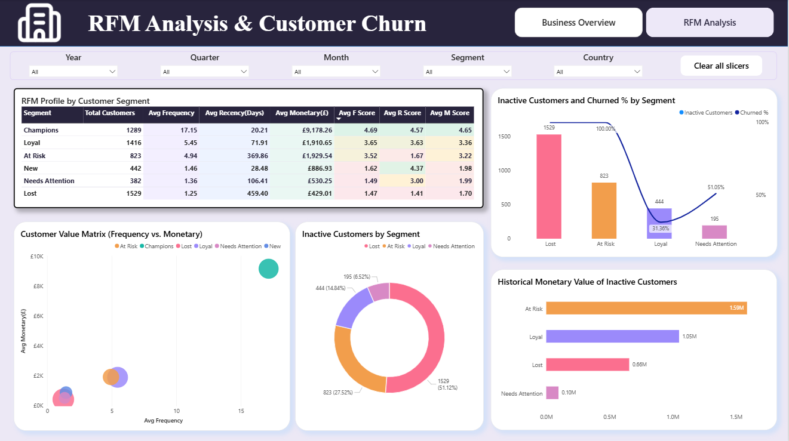

# RetailRadar — E-Commerce RFM & Customer Retention Analytics

**Customer Segmentation · RFM Analysis · 90-Day Churn Analysis · SQL Server · Power BI**

RetailRadar is an end-to-end customer analytics project I built to understand which customer groups contribute the most value to an online retailer, which groups have become inactive, and where retention attention could be prioritized.

I used **Microsoft SQL Server** to consolidate and prepare the transaction data, calculate customer-level Recency, Frequency and Monetary (RFM) metrics, assign customer segments, and create a 90-day inactivity flag. I then integrated those customer attributes back into the transaction-level data and built an interactive **Power BI report with two main analytical pages**.

I structured the report around the business questions in the accompanying customer analytics brief. Rather than treating every customer the same, I wanted to make it easier to compare customer value, purchasing behavior and inactivity across meaningful segments.

## Project at a glance

| Measure | Result |
|---|---:|
| Original Online Retail II records | **1,067,371** |
| Final integrated transaction rows | **779,495** |
| Unique identified customers | **5,881** |
| Distinct invoices in the integrated data | **36,975** |
| Countries represented after the analysis filters | **41** |
| Transaction observation period | **1 Dec 2009 – 9 Dec 2011** |
| RFM snapshot date | **10 Dec 2011** |
| Total revenue in the integrated analysis data | **£17,374,804.25** |
| Average historical monetary value per customer | **£2,954.40** |
| Customers inactive for more than 90 days | **2,991 (50.86%)** |

**How to read these figures:** The 779,495 rows and £17.37M revenue refer to the final customer-linked transaction table used by Power BI. That table is built after exact-duplicate removal and includes rows with a known `Customer_ID` and `Quantity > 0`. It is not the unfiltered total of every row in the original source files. Average customer value is the average customer-level Monetary total across the analysis period; it is not a predicted lifetime value.

---

## 1. Business context and questions

The business brief describes a UK-based, non-store online retailer selling giftware and home-decor products. It also notes that the customer base includes wholesale buyers as well as individual shoppers. That matters when interpreting Monetary value: a high-spending customer may represent wholesale purchasing rather than a typical individual shopping pattern.

I used the brief to organize the analysis around these questions:

1. **Which customer segments contribute the most revenue and customer value?**
2. **Which customers have gone quiet under the agreed 90-day inactivity definition?**
3. **How are inactive customers distributed across the RFM segments?**
4. **How much historical customer value is associated with the inactive population?**
5. **How do revenue, invoice volume and revenue contribution vary across time and countries?**

The project is descriptive and diagnostic. It identifies valuable segments and customers who meet a fixed inactivity rule so that a business could review retention priorities. It does not predict future churn or execute marketing campaigns.

---

## 2. Dataset

I used the **Online Retail II** dataset, which contains transaction-level records for a UK-based online retailer between **1 December 2009 and 9 December 2011**. The dataset contains **1,067,371 records** and includes invoice identifiers, product codes and descriptions, quantities, invoice dates, unit prices, customer identifiers and country. The source description also notes that many customers are wholesalers.

- **Original source:** [UCI Machine Learning Repository — Online Retail II](https://archive.ics.uci.edu/dataset/502/online+retail+ii)
- **Dataset DOI:** [10.24432/C5CG6D](https://doi.org/10.24432/C5CG6D)
- **Kaggle mirror:** [Online Retail II UCI — Kaggle](https://www.kaggle.com/datasets/mashlyn/online-retail-ii-uci)
- **License:** [Creative Commons Attribution 4.0 International (CC BY 4.0)](https://creativecommons.org/licenses/by/4.0/)

The raw files in the repository are separated into the two yearly source periods (`2009–2010` and `2010–2011`). In SQL Server, I imported them as:

- `dbo.[online_retail_2009-2010]`
- `dbo.[online_retail_2010-2011]`

The source fields are represented in the SQL pipeline as `Invoice`, `StockCode`, `Description`, `Quantity`, `InvoiceDate`, `Price`, `Customer_ID` and `Country`.

---

## 3. SQL Server workflow

I kept the data preparation and RFM calculations in **T-SQL**. The scripts are numbered so the workflow can be followed in sequence.

| Script | What I did |
|---|---|
| `01_DataBase Creation and Table import.sql` | Created the `CustomerAnalytics` database and checked the row counts of the two imported yearly source tables. The source files are loaded through the SSMS Import Flat File workflow. |
| `02_Data Consolidation and Validation.sql` | Combined both periods with `UNION ALL`, converted `Price` using `TRY_CONVERT(DECIMAL(10,2), ...)`, and checked for failed date and price conversions. The result is `RetailCombined`. |
| `03_Data Quality Assesment.sql` | Assessed missing customer IDs, non-positive quantities, missing descriptions and exact duplicate transaction groups. |
| `04_Data Deduplication.sql` | Used `ROW_NUMBER()` with the transaction fields as the duplicate key to retain one copy of exact duplicate rows and create `RetailCleaned`. |
| `05_RFM Calculation.sql` | Calculated customer-level Recency, Frequency and Monetary values using the fixed snapshot date of `2011-12-10`. The result is `CustomerRFM`. |
| `06_RFM Calculation and Custmer Segementation.sql` | Applied 1–5 RFM scores with `NTILE(5)`, assigned the six customer segments, and created the `IsChurned` flag. The result is `CustomerRFMSegments`. |
| `07_Customer Churn Analysis.sql` | Summarized the inactive population overall and by customer segment. |
| `08_RFM Integration.sql` | Joined the customer-level RFM attributes back to eligible transaction rows, created `InvoiceMonth` and line-level `Revenue`, and produced `RetailRFMTransactions`. |
| `09_PowerBI_Dashboard_Validation.sql` | Returned SQL comparison outputs for the Power BI KPIs, segment summaries, top countries, year/quarter trends and customer-value matrix. This is a read-only reconciliation script. |

### Main SQL tables

| Table | Grain | Purpose |
|---|---|---|
| `RetailCombined` | Transaction line | Consolidated source periods before deduplication. |
| `RetailCleaned` | Transaction line | Exact duplicates removed. |
| `CustomerRFM` | One row per customer | Recency, Frequency and Monetary metrics. |
| `CustomerRFMSegments` | One row per customer | RFM scores, segment assignment and 90-day inactivity flag. |
| `RetailRFMTransactions` | Transaction line | Final Power BI table with transaction fields and attached customer-level RFM attributes. |

### Data preparation decisions

- I consolidated the two yearly source tables into one staging table.
- I used `TRY_CONVERT` for the price conversion so conversion issues could be checked instead of silently assumed to be valid.
- I assessed missing customer identifiers, non-positive quantities, missing descriptions and exact duplicates before building the customer model.
- I removed exact duplicate transaction rows with `ROW_NUMBER()` over the invoice, stock code, description, quantity, invoice date, price, customer ID and country fields.
- I calculated RFM only for rows with a known `Customer_ID` and a positive `Quantity`.
- I calculated line revenue as `Quantity * Price` and joined the resulting customer-level attributes back to the transaction table for Power BI analysis.

---

## 4. RFM methodology and customer segmentation

I calculated RFM at the **customer level**, using **10 December 2011** as the fixed snapshot date.

| Metric | Calculation | Interpretation |
|---|---|---|
| **Recency (R)** | Days between the customer's latest `InvoiceDate` and `2011-12-10`. | Fewer days since the last purchase is better. |
| **Frequency (F)** | Count of distinct invoices for the customer during the analysis period. | More distinct purchase invoices indicates more frequent purchasing. |
| **Monetary (M)** | Sum of `Quantity * Price` for the customer's eligible transaction rows. | Higher cumulative spend indicates greater historical monetary value. |

I used `NTILE(5)` to rank customers into five score groups for each metric. Recency is reversed so that a lower number of days produces a higher R score. F and M scores increase with invoice frequency and monetary value. Each score ranges from **1 to 5**, with 5 representing the stronger result for that dimension.

### Segment rules

The SQL `CASE` expression assigns customers in this order:

| Segment | Rule / interpretation |
|---|---|
| **Champions** | `R_Score >= 4`, `F_Score >= 4` and `M_Score >= 4` — recent, frequent and high-value customers. |
| **Loyal** | `R_Score >= 3` and `F_Score >= 3` — customers with an established and reasonably recent purchase pattern. |
| **At Risk** | `R_Score <= 2` and `F_Score >= 3` — customers with a stronger historical purchase frequency but weak recency. |
| **New** | `R_Score >= 4` and `F_Score <= 2` — recent customers with a relatively low purchase frequency. |
| **Needs Attention** | `R_Score = 3` and `F_Score <= 2` — customers with moderate recency but low purchase frequency. |
| **Lost** | Remaining score combinations not assigned by the preceding rules. |

### 90-day churn / inactivity definition

The project brief defines churn as no recorded purchase activity in the trailing 90 days. I implemented that as a fixed rule at the RFM snapshot:

```sql
CASE
    WHEN Recency > 90 THEN 1
    ELSE 0
END AS IsChurned
```

In this project, **`IsChurned = 1` means the customer had more than 90 days since their latest recorded purchase as of 10 December 2011**. It is a transparent, rule-based inactivity flag. It is not a machine-learning prediction, a confirmed cancellation, or a recorded churn event date.

---

## 5. Power BI dashboard

I used `RetailRFMTransactions` as the main transaction table, a `Dim_Date` calendar table for date filtering, and a `Project_measures` table to organize DAX measures. The report has two main analytical pages and an auxiliary report-page tooltip for revenue formatting.

Both main pages use the same slicer set: **Year, Quarter, Month, Segment and Country**. The date slicers provide period context for transaction and revenue analysis. The RFM scores and the 90-day inactivity flag remain based on the fixed 10 December 2011 customer snapshot; they are not recalculated as separate historical churn snapshots for each month or quarter.

### Power BI model

- **`RetailRFMTransactions`** is the main transaction-level table used by the report. It contains invoice and revenue fields alongside the customer-level RFM scores, segment and inactivity flag.
- **`Dim_Date`** provides the date hierarchy used by the Year, Quarter and Month slicers and the time-series visuals.
- **`Project_measures`** is the measure table used to organize the DAX calculations for customer counts, revenue, average customer value, active/inactive customers, inactivity rate and historical monetary value.

Because customer-level RFM attributes are attached to transaction rows, I calculate customer counts and RFM averages at the distinct-customer level rather than treating every repeated transaction row as a separate customer.

### Page 1 — Business Overview



I started with a business-level view so that the reader can understand customer scale, revenue contribution, retention status and the main time and country patterns before moving into the RFM detail.

**KPI cards**

| KPI | Dashboard result | What it tells me |
|---|---:|---|
| Total Customers | 5,881 | Number of identified customers represented in the customer-level analysis. |
| Total Revenue | £17.37M | Revenue from the eligible, customer-linked transaction rows. |
| Average Customer Value | £2.95K | Average historical Monetary value per customer. |
| Churned % | 50.86% | Share of customers with more than 90 days since their last purchase at the snapshot. |

**Visuals**

1. **Revenue Contribution by Customer Segment** — I used a revenue-and-customer combo chart to compare the revenue generated by each segment with the number of customers in that segment. This keeps customer volume and revenue contribution in the same view.
2. **Customer Retention by Customer Segment** — I used a stacked bar chart to compare active and inactive customer counts across the six RFM segments.
3. **Top 5 Countries by Revenue** — I used a ranked horizontal bar chart to identify the countries contributing the largest amount of revenue.
4. **Total Revenue by Year and Quarter** — I used a time-series visual to compare revenue across the available quarters.
5. **Orders by Year and Quarter** — I paired the revenue trend with invoice volume so that changes in revenue can be viewed alongside changes in the number of orders.

**What this page helps me investigate:** which segments contribute the most revenue, how active and inactive customers are distributed, which countries lead in revenue, and how revenue and invoice volume move over the observation period.

### Page 2 — RFM Analysis & Customer Churn



On the second page, I move from the overall business picture to customer-level value and inactivity. I wanted to show not only which segments are inactive, but also how those customers compare in their historical purchasing behavior and monetary value.

**Visuals**

1. **RFM Profile by Customer Segment** — A customer-segment table showing customer count, average Frequency, average Recency, average Monetary value and the average R, F and M scores. I kept both actual metrics and scores so the reader can see the underlying behavior as well as the relative score.
2. **Customer Value Matrix (Frequency vs. Monetary)** — A scatter chart comparing average invoice frequency with average monetary value by segment. Bubble size represents the number of customers, allowing segment size and customer value to be viewed together.
3. **Inactive Customers and Churned % by Segment** — A combo chart comparing the number of inactive customers with the 90-day inactivity rate for each segment.
4. **Inactive Customers by Segment** — A doughnut chart showing how the total inactive customer population is distributed across the segments.
5. **Historical Monetary Value of Inactive Customers** — A horizontal bar chart showing the historical Monetary value represented by inactive customers in each segment. I use this to identify where inactive customers had previously generated meaningful value.

**What this page helps me investigate:** which segments are valuable, which contain the largest inactive populations, how inactivity rates differ by segment, and where the inactive population has the greatest historical monetary value.

---

## 6. Key findings from the analysis

The following figures are calculated from the final customer-level RFM output and integrated transaction data.

| Customer segment | Customers | Historical revenue | 90-day inactivity rate |
|---|---:|---:|---:|
| Champions | 1,289 | £11,830,781.14 | 0.00% |
| Loyal | 1,416 | £2,705,479.18 | 31.36% |
| At Risk | 823 | £1,588,013.79 | 100.00% |
| New | 442 | £392,021.57 | 0.00% |
| Needs Attention | 382 | £202,557.09 | 51.05% |
| Lost | 1,529 | £655,951.48 | 100.00% |
| **Total** | **5,881** | **£17,374,804.25** | **50.86%** |

### What stood out to me

- **Champions are the largest source of historical revenue.** The 1,289 Champions generated approximately **£11.83M**, or **68.09%** of total revenue. Champions and Loyal customers together contributed approximately **£14.54M (83.66%)**.
- **The inactive population is substantial.** I identified **2,991 customers (50.86%)** with more than 90 days since their last purchase at the snapshot.
- **Inactive customers are concentrated in four segments.** Lost accounts for 1,529 inactive customers, At Risk for 823, Loyal for 444, and Needs Attention for 195. Champions and New have no customers meeting the 90-day inactivity rule in this output.
- **Inactivity rate and inactive customer count tell different stories.** At Risk and Lost are both 100% inactive under the implemented definitions, but Lost has the larger customer count. Loyal has 444 inactive customers, representing 31.36% of that segment, while Needs Attention has 195 inactive customers, representing 51.05%.
- **Historical value is not the same as lost revenue.** Inactive customers represent approximately **£3.39M in historical Monetary value**. This is the sum of what those customers spent during the observation period; it is not a forecast of revenue that will be lost or recovered.
  - By segment, the inactive historical Monetary value is approximately **£1.59M for At Risk**, **£1.05M for Loyal**, **£0.66M for Lost**, and **£0.10M for Needs Attention**.
- **The United Kingdom is the leading revenue market** in the integrated data, contributing approximately **£14.39M**.

### How I would use the segment results

| Segment | Possible business response |
|---|---|
| Champions | Protect the relationship and recognize the customers who contribute the strongest historical value. |
| Loyal | Encourage repeat purchasing and review the 90-day inactive subset before it grows. |
| At Risk | Prioritize a win-back review, especially for customers with stronger historical Frequency and Monetary value. |
| New | Encourage a second purchase and help recent, low-frequency customers become established buyers. |
| Needs Attention | Focus on repeat-purchase engagement and monitor customers whose recency is starting to weaken. |
| Lost | Use a cost-conscious reactivation approach and compare the effort with each customer's historical value. |

These are potential actions suggested by the descriptive analysis. I did not execute campaigns or test whether any action changes customer behavior.

---

## 7. Dashboard validation

I added `09_PowerBI_Dashboard_Validation.sql` as a lightweight reconciliation step. It is **read-only** and returns SQL result sets that I can compare with the corresponding Power BI visuals.

The script provides checks for:

1. Total customers, total revenue, average customer value and the 90-day inactivity rate.
2. Revenue, active customers, inactive customers and inactivity rate by segment.
3. The top five countries by revenue.
4. Revenue and distinct invoice counts by year and quarter.
5. Customer-level RFM averages, segment counts and inactive historical Monetary value.
6. Average Frequency, average Monetary and customer count by segment for the customer-value matrix.

I use these outputs as evidence that the report figures reconcile to the SQL data. The script does not modify the database or automatically certify that a Power BI refresh has succeeded; the returned values need to be compared with the report after the model is refreshed.

---

## 8. Repository structure

```text
RetailRadar/
│
├── PowerBI/
│   └── E-Commerce RFM & Customer Retention Analytics.pbix
│
├── Raw Datasets/
│   ├── online_retail_2009-2010   # first yearly source file
│   └── online_retail_2010-2011   # second yearly source file
│
├── Screenshots/
│   ├── Business_Overview.png
│   └── RFM_Analysis_Customer_Churn.png
│
├── SQL Scripts/
│   ├── 01_DataBase Creation and Table import.sql
│   ├── 02_Data Consolidation and Validation.sql
│   ├── 03_Data Quality Assesment.sql
│   ├── 04_Data Deduplication.sql
│   ├── 05_RFM Calculation.sql
│   ├── 06_RFM Calculation and Custmer Segementation.sql
│   ├── 07_Customer Churn Analysis.sql
│   ├── 08_RFM Integration.sql
│   └── 09_PowerBI_Dashboard_Validation.sql
│
└── README.md
```

The two raw source filenames above are shown without extensions because Windows Explorer was displaying file extensions as hidden. Keep the actual filenames and extensions from the `Raw Datasets` folder when you upload the repository.

---

## 9. How to reproduce the analysis

### Requirements

- Microsoft SQL Server
- SQL Server Management Studio (SSMS)
- Power BI Desktop
- The two yearly Online Retail II source files in `Raw Datasets/`

### Run the SQL pipeline

1. Create the `CustomerAnalytics` database using the database creation section in Script 01.
2. Use **Import Flat File** in SSMS to load the two yearly source files into `dbo.[online_retail_2009-2010]` and `dbo.[online_retail_2010-2011]`.
3. Run the row-count checks in Script 01 to confirm that both source tables were imported.
4. Execute Scripts **02 through 08 in numeric order** to consolidate, assess, deduplicate, calculate RFM, assign segments, flag 90-day inactivity and create the integrated transaction table.
5. Run Script 09 and compare its result sets with the matching Power BI cards, charts and tables.

The table-creation scripts use `SELECT ... INTO` for intermediate outputs, so run the pipeline in order on a clean database or remove the existing output tables before rebuilding it.

### Open the Power BI report

1. Open `PowerBI/E-Commerce RFM & Customer Retention Analytics.pbix` in Power BI Desktop.
2. If your SQL Server instance differs from the one used when the report was built, update the source connection to your local SQL Server and the `CustomerAnalytics` database.
3. Refresh the model after the SQL pipeline has completed.
4. Compare the refreshed report with the result sets from Script 09.

---

## 10. Assumptions and limitations

- **Fixed snapshot:** RFM metrics and `IsChurned` are calculated as of **10 December 2011**. The report does not reconstruct a separate RFM or churn status for every historical month.
- **Rule-based inactivity:** The 90-day threshold is an agreed business rule from the brief. It is not a statistically estimated cutoff or a predictive churn model.
- **No churn event date or reason:** The source data records purchases, not confirmed cancellation events, reasons for leaving, customer feedback or reactivation history. I can identify inactivity under the defined rule, but I cannot establish why a customer stopped buying.
- **Wholesale and individual buyers are mixed:** The source description notes that many customers are wholesalers, but the available fields do not reliably separate wholesale buyers from individual shoppers. High Monetary values may therefore reflect bulk purchasing.
- **Customer-linked analysis:** Rows without a `Customer_ID` cannot be assigned to a customer segment and are not included in the final customer-linked Power BI fact table. Rows with `Quantity <= 0` are also excluded from the RFM and integrated sales calculations.
- **Historical value is not predicted value:** Monetary is the sum of eligible historical transaction revenue during the observation period. It is not a forecast, customer lifetime value model or estimate of recoverable churn revenue.
- **Campaign execution is out of scope:** The project provides segment-level evidence and possible retention priorities. It does not run marketing campaigns or measure campaign lift.

---

## 11. Dataset citation

Chen, D. (2012). **Online Retail II** [Dataset]. UCI Machine Learning Repository. https://doi.org/10.24432/C5CG6D

The dataset is distributed under the [CC BY 4.0 license](https://creativecommons.org/licenses/by/4.0/). Please retain the source attribution when reusing or redistributing the data.

---

## Author

**Abhishek Mishra**  
GitHub: [@abnabhi0084](https://github.com/abnabhi0084)
