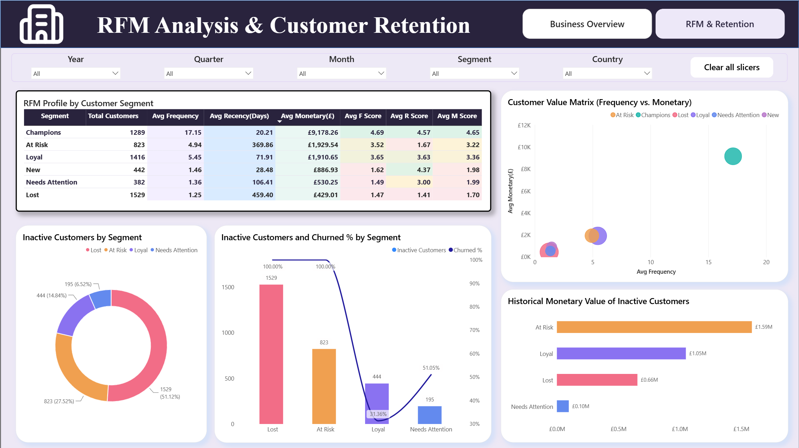

# RetailRadar — E-Commerce RFM & Customer Retention Analytics

**Customer Segmentation · RFM Analysis · 90-Day Inactivity Analysis · SQL Server · Power BI**

RetailRadar is an end-to-end customer analytics project built to understand which customer groups contribute the most historical value, which customers have become inactive, and where a retailer could prioritize retention attention.

I used **Microsoft SQL Server** to consolidate and clean the Online Retail II transaction data, calculate customer-level Recency, Frequency and Monetary (RFM) metrics, assign customer segments, and create a 90-day inactivity flag. I then built an interactive **Power BI report with two analytical pages**.

The final model deliberately keeps transaction-level activity separate from customer-level RFM attributes. This avoids repeating customer metrics across every invoice line and makes the analytical grain clearer.

---

## Project at a glance

| Measure | Result |
|---|---:|
| Original Online Retail II records | **1,067,371** |
| Final cleaned transaction rows | **779,407** |
| Identified customers | **5,881** |
| Transaction observation period | **1 Dec 2009 – 9 Dec 2011** |
| RFM snapshot date | **10 Dec 2011** |
| Total revenue | **£17.37M** |
| Average historical Monetary value per customer | **£2.95K** |
| Customers inactive for more than 90 days | **2,991 (50.86%)** |

**How to read these figures:** The 779,407 rows are the final `RetailCleaned` transaction-line records after the cleaning and deduplication process. The revenue figure is calculated from eligible transaction lines as `Quantity * Price`. Average customer value is the average customer-level Monetary value over the observation period; it is not predicted customer lifetime value. The inactivity rate is based on a fixed snapshot date of 10 December 2011.

---

## 1. Business context and questions

The Online Retail II case describes a UK-based, non-store online retailer selling giftware and home-decor products. Its customer base includes both wholesalers and individual shoppers, which matters when interpreting Monetary value: a high-spending customer may represent wholesale purchasing rather than a typical individual shopping pattern.

I organized the analysis around these business questions:

1. **Which customer segments contribute the most revenue and historical customer value?**
2. **Which customers meet the agreed 90-day inactivity definition?**
3. **How are inactive customers distributed across the RFM segments?**
4. **How does the inactive population's historical Monetary value differ by segment?**
5. **How do revenue, invoice volume and country contribution vary across the observation period?**

The project is descriptive and diagnostic. It identifies customer groups and customers who meet a transparent inactivity rule so that a business could review retention priorities. It does not predict future churn or execute marketing campaigns.

---

## 2. Dataset

I used the **Online Retail II** dataset, which contains transaction-level records for a UK-based online retailer from **1 December 2009 to 9 December 2011**. The dataset contains 1,067,371 records and includes invoice identifiers, product codes and descriptions, quantities, invoice dates, unit prices, customer identifiers and country. The source description also notes that many customers are wholesalers.

- **Original source:** [UCI Machine Learning Repository — Online Retail II](https://archive.ics.uci.edu/dataset/502/online+retail+ii)
- **Dataset DOI:** [10.24432/C5CG6D](https://doi.org/10.24432/C5CG6D)
- **Kaggle mirror:** [Online Retail II UCI — Kaggle](https://www.kaggle.com/datasets/mashlyn/online-retail-ii-uci)
- **License:** [Creative Commons Attribution 4.0 International (CC BY 4.0)](https://creativecommons.org/licenses/by/4.0/)

The two yearly source files were imported into SQL Server as:

- `dbo.[online_retail_2009-2010]`
- `dbo.[online_retail_2010-2011]`

The source fields used in the analysis are `Invoice`, `StockCode`, `Description`, `Quantity`, `InvoiceDate`, `Price`, `Customer_ID` and `Country`. The consolidation step also adds `SourceSheet` to retain the source-period label.

---

## 3. SQL Server workflow

All data preparation, RFM calculations, segmentation and churn-rule implementation are performed in **T-SQL**. The eight scripts are intended to be run in numeric order.

| Script | Purpose |
|---|---|
| `01_DataBase Creation and Table import.sql` | Creates the `CustomerAnalytics` database and checks the row counts of the two imported yearly source tables. The source files are loaded through the SSMS Import Flat File workflow. |
| `02_Data Consolidation and Validation.sql` | Combines both yearly tables with `UNION ALL`, safely converts `Price` using `TRY_CONVERT(DECIMAL(10,2), ...)`, and checks date and price conversion results. Creates `RetailCombined`. |
| `03_Data Quality Assesment.sql` | Assesses missing customer identifiers, non-positive quantities, missing descriptions and exact duplicate transaction groups before final cleaning. |
| `04_Data Deduplication and NULL Handling.sql` | Applies the final row filters in the CTE, including a known `Customer_ID`, positive `Price` and positive `Quantity`; uses `ROW_NUMBER()` over the transaction fields to retain one copy of exact duplicate rows; creates `RetailCleaned`; and runs duplicate, NULL and invalid-value checks. |
| `05_RFM Calculation.sql` | Calculates customer-level Recency, Frequency and Monetary metrics from `RetailCleaned`, using the fixed snapshot date `2011-12-10`. Creates the intermediate customer-level table `CustomerRFM`. |
| `06_RFM Calculation and Custmer Segementation.sql` | Applies 1–5 RFM scores using `NTILE(5)`, assigns the six customer segments, and creates the `IsChurned` flag. Creates `CustomerRFMSegments`. |
| `07_Customer Churn Analysis.sql` | Summarizes the 90-day inactive population overall and by customer segment. |
| `08_PowerBI Dashboard Validation.sql` | Runs read-only SQL cross-checks for the final Power BI KPIs, revenue by segment, top countries, quarterly revenue and customer-level RFM visuals. |

### Final analytical tables and supporting tables

The Power BI model uses **two final analytical tables at different grains**. The SQL workflow also creates staging and intermediate tables to support reproducibility.

| Table | Grain | Role |
|---|---|---|
| `RetailCleaned` | One row per cleaned transaction line | Final transaction-level table for revenue, invoice, date and country analysis. |
| `CustomerRFMSegments` | One row per customer | Final customer-level table for Recency, Frequency, Monetary, RFM scores, segment and inactivity flag. |
| `RetailCombined` | Transaction line | Staging table that combines the two yearly source periods before cleaning. |
| `CustomerRFM` | One row per customer | Intermediate output containing the RFM metrics before scoring and segmentation. |

### Data preparation decisions

- I consolidated the two source periods into `RetailCombined` before applying the final cleaning logic.
- I used `TRY_CONVERT` for price conversion so conversion issues could be checked rather than silently assumed to be valid.
- I assessed missing customer identifiers, non-positive quantities, missing descriptions and exact duplicate transaction groups before creating the final clean table.
- In the cleaning CTE, I retained records with a non-NULL `Customer_ID`, `Price > 0` and `Quantity > 0`.
- I used `ROW_NUMBER()` with the invoice, stock code, description, quantity, invoice date, price, customer ID and country as the duplicate key, retaining one row per exact duplicate group.
- The final validation checks showed **779,407 rows**, zero remaining duplicate groups, zero NULLs in the checked output columns, and zero non-positive quantities or prices.
- I calculated line revenue as `Quantity * Price` in Power BI measures and SQL validation queries, rather than storing customer-level attributes repeatedly on every transaction line.

---

## 4. RFM methodology and customer segmentation

RFM is calculated at the **customer level**, using **10 December 2011** as the fixed snapshot date.

| Metric | Calculation | Interpretation |
|---|---|---|
| **Recency (R)** | Days between the customer's latest `InvoiceDate` and `2011-12-10`. | Fewer days since the last purchase is better. |
| **Frequency (F)** | Count of distinct invoices for the customer during the analysis period. | More distinct purchase invoices indicate more frequent purchasing. |
| **Monetary (M)** | Sum of `Quantity * Price` for the customer's eligible transaction lines. | Higher cumulative spend indicates greater historical monetary value. |

I used `NTILE(5)` to assign customers to five score groups for each RFM metric. Recency is reversed so a lower number of days produces a higher R score. F and M scores increase with invoice frequency and Monetary value. Each score ranges from **1 to 5**, with 5 representing the stronger result for that dimension.

### Segment rules

The SQL `CASE` expression assigns customers in this order:

| Segment | Rule / interpretation |
|---|---|
| **Champions** | `R_Score >= 4`, `F_Score >= 4` and `M_Score >= 4` — recent, frequent and high-value customers. |
| **Loyal** | `R_Score >= 3` and `F_Score >= 3` — customers with an established and reasonably recent purchase pattern. |
| **At Risk** | `R_Score <= 2` and `F_Score >= 3` — customers with stronger historical purchase frequency but weak recency. |
| **New** | `R_Score >= 4` and `F_Score <= 2` — recent customers with relatively low purchase frequency. |
| **Needs Attention** | `R_Score = 3` and `F_Score <= 2` — customers with moderate recency but low purchase frequency. |
| **Lost** | Remaining score combinations not assigned by the preceding rules. |

### 90-day churn / inactivity definition

The business brief defines churn as no recorded purchase activity in the trailing 90 days. I implemented this as a fixed rule at the RFM snapshot:

```sql
CASE
    WHEN Recency > 90 THEN 1
    ELSE 0
END AS IsChurned
```

In this project, **`IsChurned = 1` means the customer's latest recorded purchase was more than 90 days before 10 December 2011**. It is a transparent, rule-based inactivity flag. It is not a machine-learning prediction, a confirmed cancellation, or a recorded churn event date.

---

## 5. Power BI data model

The final Power BI model separates transaction activity from customer profile attributes:

- **`RetailCleaned`** is the transaction-level table used for revenue, distinct invoice counts, country analysis and time-based transaction visuals.
- **`CustomerRFMSegments`** is the customer-level table used for customer counts, RFM averages, segment analysis and inactivity measures.
- **`Dim_Date`** is the calendar table related to `RetailCleaned[InvoiceDate]` and provides Year, Quarter and Month fields for transaction-date analysis.
- **`Project_measures`** is the dedicated table used to organize DAX measures.

The intended relationship is:

`CustomerRFMSegments[Customer_ID]` **(1) → (*)** `RetailCleaned[Customer_ID]`

`Dim_Date[Date]` **(1) → (*)** `RetailCleaned[InvoiceDate]`

Both relationships should be active and use single-direction filtering toward `RetailCleaned`. This allows a customer segment to filter its related transaction rows without duplicating the customer-level RFM values across transaction lines.

### Measure design

- **Revenue:** Sum of `RetailCleaned[Quantity] * RetailCleaned[Price]`.
- **Orders:** Distinct count of `RetailCleaned[Invoice]`.
- **Total Customers:** Distinct count of `CustomerRFMSegments[Customer_ID]`.
- **Average Customer Value:** Average of customer-level `CustomerRFMSegments[Monetary]`.
- **Average RFM metrics and scores:** Calculated from the corresponding columns in `CustomerRFMSegments`.
- **Inactive Customers and Inactivity Rate:** Calculated from `CustomerRFMSegments[IsChurned]`.
- **Inactive Historical Monetary:** Sum of `CustomerRFMSegments[Monetary]` for customers with `IsChurned = 1`.

The Year, Quarter and Month date fields provide transaction-period context. RFM values and the inactivity flag remain attributes calculated at the fixed 10 December 2011 snapshot; the report does not calculate a new historical RFM snapshot for each selected month or quarter.

---

## 6. Power BI dashboard

The report contains **two main analytical pages** and an auxiliary revenue tooltip page. Both main pages use the shared slicers **Year, Quarter, Month, Segment and Country**. The second page is titled **RFM Analysis & Customer Retention** in the dashboard header; its navigation button and page tab are labeled **RFM & Retention**.

### Page 1 — Business Overview


This page provides a business-level view of customer scale, revenue contribution, retention status, country contribution and quarterly revenue movement.

**KPI cards**

| KPI | Dashboard result | What it tells me |
|---|---:|---|
| Total Customers | 5,881 | Identified customers represented in the customer-level analysis. |
| Total Revenue | £17.37M | Revenue from the eligible cleaned transaction lines. |
| Average Customer Value | £2.95K | Average historical Monetary value per customer. |
| Churned % | 50.86% | Share of customers with more than 90 days since their last purchase at the fixed snapshot. |

**Visuals**

1. **Revenue Contribution by Customer Segment** — a combo chart comparing revenue generated by each segment with its customer count.
2. **Customer Retention by Customer Segment** — a stacked bar chart comparing active and inactive customer counts across the six RFM segments.
3. **Top 5 Countries by Revenue** — a ranked horizontal bar chart showing the countries contributing the largest revenue.
4. **Total Revenue by Year and Quarter** — a time-series visual comparing revenue across the available quarters.

**What this page helps investigate:** which segments contribute the most revenue, how active and inactive customers are distributed, which countries lead in revenue, and how revenue changes across the observation period.

### Page 2 — RFM Analysis & Customer Retention



The dashboard header displays **RFM Analysis & Customer Retention**, while the navigation button and page tab display **RFM & Retention**. This page moves from the overall business picture to customer-level value and inactivity. It compares segment purchasing behavior, customer counts, inactivity and historical monetary value to help identify where retention attention may be most useful.

**Visuals**

1. **RFM Profile by Customer Segment** — a table showing customer count, average Frequency, average Recency, average Monetary value and average R, F and M scores.
2. **Inactive Customers and Churned % by Segment** — a combo chart comparing inactive customer counts with the 90-day inactivity rate for each segment.
3. **Customer Value Matrix (Frequency vs. Monetary)** — a scatter chart comparing average Frequency with average Monetary value by segment. Segment is used to distinguish the groups, and bubble size represents the customer count where configured in the visual.
4. **Inactive Customers by Segment** — a doughnut chart showing how the inactive customer population is distributed across the segments.
5. **Historical Monetary Value of Inactive Customers** — a horizontal bar chart showing the historical Monetary value represented by inactive customers in each segment. This is historical spend, not predicted lost revenue.

**What this page helps investigate:** which segments have stronger historical purchasing behavior, where inactivity is concentrated, how inactivity rates differ by segment, and which inactive segments represent greater historical Monetary value.

---

## 7. Key findings

The current Business Overview highlights the following results:

- **Champions contribute the largest share of revenue.** The segment contributes approximately **£11.8M** of the **£17.37M** total revenue shown in the report (approximately 68%).
- **Customer inactivity is material.** The report identifies **2,991 customers (50.86%)** whose last recorded purchase was more than 90 days before the fixed snapshot date.
- **Retention needs differ by segment.** The active/inactive split and inactivity-rate visual distinguish segments with large inactive populations from segments with a high inactivity proportion.
- **The United Kingdom is the leading revenue country**, contributing approximately **£14.4M** in the Top 5 Countries visual.
- **Historical Monetary value should not be interpreted as lost revenue.** It represents what inactive customers spent during the observation period, not revenue that is certain to be lost or recovered.

### Potential business responses

| Segment | Possible business response |
|---|---|
| Champions | Protect the relationship and recognize customers with the strongest historical value. |
| Loyal | Encourage repeat purchasing and review inactive customers within the segment. |
| At Risk | Prioritize a win-back review, especially for customers with stronger historical Frequency and Monetary value. |
| New | Encourage a second purchase and help recent, low-frequency customers become established buyers. |
| Needs Attention | Focus on repeat-purchase engagement and monitor customers whose recency is weakening. |
| Lost | Use a cost-conscious reactivation approach and compare the effort with historical customer value. |

These are possible actions suggested by descriptive analysis. I did not execute campaigns or test whether any action changes customer behavior.

---

## 8. Dashboard validation

`08_PowerBI Dashboard Validation.sql` is a **read-only reconciliation script**. It returns SQL result sets that can be compared with the corresponding Power BI cards, charts and tables after the model is refreshed.

The validation workflow checks:

1. Total customers, total revenue, average customer value, inactive customers and the 90-day inactivity rate.
2. Revenue, active customers, inactive customers and inactivity rate by segment.
3. The top five countries by revenue.
4. Revenue by year and quarter.
5. Customer-level RFM averages, segment counts, inactivity rate and inactive historical Monetary value.
6. Average Frequency, average Monetary and customer count by segment for the customer-value scatter chart.

The SQL validation script does not modify the database or automatically certify that a Power BI refresh has succeeded. Its result sets must be compared with the report using the same filter context.

---

## 9. Repository structure

```text
RetailRadar/
│
├── PowerBI/
│   └── E-Commerce RFM & Customer Retention Analytics.pbix
│
├── Raw Datasets/
│   ├── online_retail_2009-2010
│   └── online_retail_2010-2011
│
├── Screenshots/
│   ├── Business_Overview.png
│   └── RFM_Analysis_Customer_Retention.png
│
├── SQL Scripts/
│   ├── 01_DataBase Creation and Table import.sql
│   ├── 02_Data Consolidation and Validation.sql
│   ├── 03_Data Quality Assesment.sql
│   ├── 04_Data Deduplication and NULL Handling.sql
│   ├── 05_RFM Calculation.sql
│   ├── 06_RFM Calculation and Custmer Segementation.sql
│   ├── 07_Customer Churn Analysis.sql
│   └── 08_PowerBI Dashboard Validation.sql
│
└── README.md
```

The raw dataset filenames are shown without extensions here; use the actual filenames and extensions included in the repository.

---

## 10. How to reproduce the analysis

### Requirements

- Microsoft SQL Server
- SQL Server Management Studio (SSMS)
- Power BI Desktop
- The two yearly Online Retail II source files in `Raw Datasets/`

### Run the SQL pipeline

1. Create the `CustomerAnalytics` database using Script 01.
2. Use **Import Flat File** in SSMS to load the two yearly source files into `dbo.[online_retail_2009-2010]` and `dbo.[online_retail_2010-2011]`.
3. Run the row-count checks in Script 01 to confirm that both source tables were imported.
4. Execute Scripts **02 through 07 in numeric order** to consolidate, assess, clean and deduplicate the transactions, calculate RFM, assign customer segments and flag 90-day inactivity.
5. Run Script 08 to generate the read-only validation result sets.

The table-creation scripts use `SELECT ... INTO` for output tables. Run the pipeline in order on a clean database, or remove existing output tables before rebuilding them.

### Open the Power BI report

1. Open `PowerBI/E-Commerce RFM & Customer Retention Analytics.pbix` in Power BI Desktop.
2. If your SQL Server instance differs from the one used when the report was built, update the source connection to your local SQL Server and the `CustomerAnalytics` database.
3. Refresh the model after the SQL pipeline has completed.
4. Compare the refreshed report with the result sets from Script 08, using matching slicer and filter selections.

---

## 11. Assumptions and limitations

- **Fixed snapshot:** RFM metrics and `IsChurned` are calculated as of **10 December 2011**. The report does not reconstruct a separate RFM or churn status for every historical month.
- **Rule-based inactivity:** The 90-day threshold is a business rule from the brief. It is not a statistically estimated cutoff or a predictive churn model.
- **No churn event date or reason:** The source data records purchases, not confirmed cancellation events, reasons for leaving, customer feedback or reactivation history. The analysis identifies inactivity under the defined rule but cannot establish why a customer stopped buying.
- **Wholesale and individual buyers are mixed:** The source description notes that many customers are wholesalers, but the available fields do not reliably separate wholesale buyers from individual shoppers. High Monetary values may therefore reflect bulk purchasing.
- **Customer-linked analysis:** Rows without a `Customer_ID`, rows with `Price <= 0`, and rows with `Quantity <= 0` are excluded from the final cleaned transaction table used for this analysis.
- **Historical value is not predicted value:** Monetary is the sum of eligible historical transaction revenue during the observation period. It is not a forecast, a customer lifetime value model or an estimate of recoverable churn revenue.
- **Campaign execution is out of scope:** The project provides segment-level evidence and possible retention priorities. It does not run marketing campaigns or measure campaign lift.

---

## 12. Dataset citation

Chen, D. (2012). **Online Retail II** [Dataset]. UCI Machine Learning Repository. https://doi.org/10.24432/C5CG6D

The dataset is distributed under the [CC BY 4.0 license](https://creativecommons.org/licenses/by/4.0/). Please retain the source attribution when reusing or redistributing the data.

---

## Author

**Abhishek Mishra**  
GitHub: [@abnabhi0084](https://github.com/abnabhi0084)
